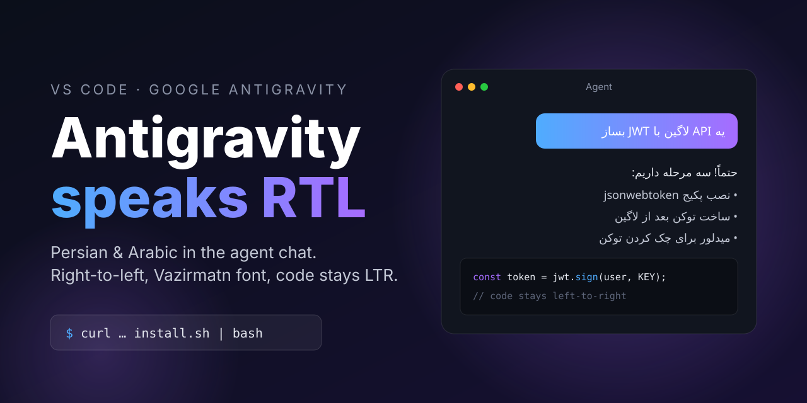

# vscode-antigravity-rtl

RTL (Persian / Arabic) support for the chat panel of the **Google Antigravity** extension in VS Code.

- Right-to-left text, auto-detected per paragraph
- [Vazirmatn](https://github.com/rastikerdar/vazirmatn) font for Persian/Arabic glyphs
- Code blocks stay LTR
- **Add to Antigravity Chat** in the Explorer / tab right-click menu (VS Code blocks dragging files into the chat)
- Auto re-patch after extension updates
- Linux, macOS, Windows

> [!WARNING]
> This is a **vibe-coded** project. It patches another extension's code. Use at your own risk — **no warranty, no responsibility** for anything it breaks.

## Install

Requires Node.js and git.

**Linux / macOS**

```bash
curl -fsSL https://raw.githubusercontent.com/njfamirm/vscode-antigravity-rtl/main/install.sh | bash
```

**Windows (PowerShell)**

```powershell
irm https://raw.githubusercontent.com/njfamirm/vscode-antigravity-rtl/main/install.ps1 | iex
```

Then fully restart VS Code.

Auto re-patch uses a systemd path unit (Linux), a launchd agent (macOS) or a logon scheduled task (Windows).

## Uninstall

```bash
bash ~/.local/share/vscode-antigravity-rtl/install.sh --uninstall
```

On Windows: `node $env:LOCALAPPDATA\vscode-antigravity-rtl\patch.js --uninstall` and remove the `vscode-antigravity-rtl` scheduled task.

## How it works

The chat UI is an iframe served by the `agy` binary (UI embedded, cross-origin), so custom CSS tricks can't reach it. `patch.js` changes one line in the extension's `extension.js` so the iframe goes through `rtl-proxy.js`, a tiny local proxy that injects `dir="auto"`, `unicode-bidi: plaintext` and the font into the page. If the proxy fails, the original URL is used.

## DIY with an AI agent

Patch broke after an update? Give this prompt to Claude Code (or any coding agent):

> The chat panel of the Google Antigravity extension in VS Code has no RTL support. Find the extension in `~/.vscode/extensions`, figure out how the chat UI is loaded, and patch it so Persian/Arabic text renders right-to-left (`dir="auto"`, code blocks stay LTR). Keep a backup of anything you change.

## License

MIT
